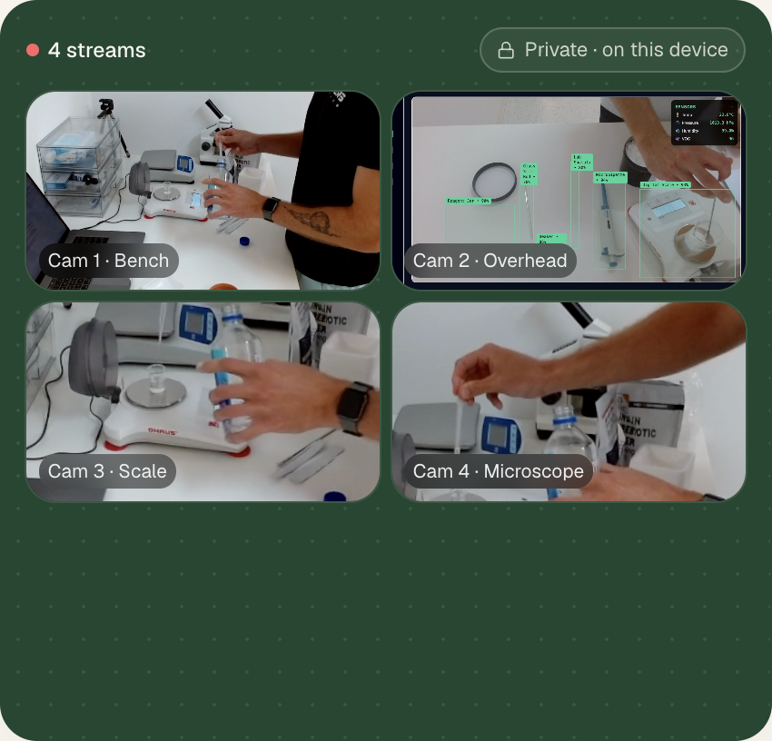
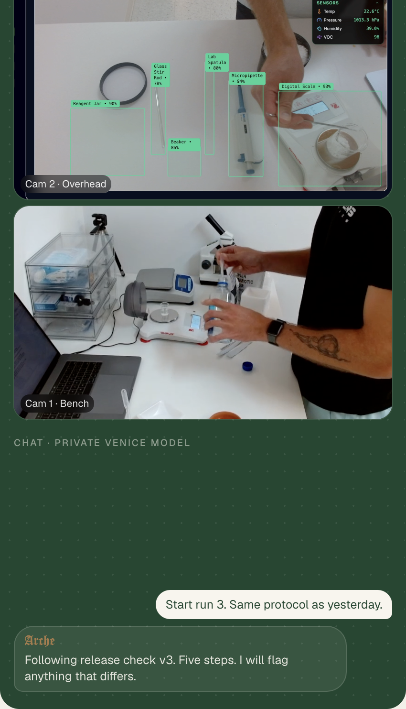

<p align="center">
  
</p>

# Arche Vision

Arche Vision is a camera-based system for observing and documenting real-world experimental work. It follows a procedure as it is performed, converts visible activity into a timestamped experimental record, and provides contextual assistance while the work is still in progress.

Protocols describe what should happen. Conventional notes usually capture only a fraction of what did happen. The experimental process between those two records—handling decisions, repeated actions, pauses, deviations, instrument interactions, and changes in the state of the bench—is often where important context is lost. Arche Vision is intended to make that process more legible without requiring the researcher to stop working and narrate every action.

The researcher supplies the experimental objective, procedural context, and any instructions that should guide interpretation. Arche Vision can use up to four concurrent camera feeds in the full platform, or analyze an existing recording. Before a run begins, a vision model detects the instruments, samples, vessels, and other relevant objects in a representative frame. The researcher reviews that scene model by correcting labels, removing false detections, and adding anything the model missed.

During the run, Arche Vision operates alongside the experiment. It samples the visual stream, analyzes short temporal windows, maintains continuity with the preceding record, and writes concise lab-log entries when a meaningful action or state change occurs. The same evolving record supports questions during the run, review after the run, and comparison across repeated runs.

Arche Vision uses private multimodal models supplied through [Venice](https://venice.ai). The current implementation primarily uses the Qwen VL family; this open edition defaults to Qwen3 VL. Requests are refused unless Venice currently classifies the selected model as private.

This repository contains a self-hosted, bring-your-own-key edition of Arche Vision. A more extensive, commercially available implementation is part of [Arche](https://www.archescience.ai), where Vision is integrated with experiments, protocols, batches, lab records, footage, manual notes, collaborative labs, and the broader research workspace.

<p align="center">
  
</p>

<p align="center">
  
  
  
  
</p>

## How it works

1. **Describe the experiment.** Provide a title, objective, and the context needed to interpret the work. In the full Arche platform, a run can also be grounded in a protocol and related lab material.
2. **Choose the visual source.** Connect one or more cameras to observe the experiment as it happens, or provide an existing video for retrospective processing. The open edition currently processes a single camera or uploaded recording; the full platform supports up to four concurrent feeds.
3. **Calibrate the scene.** Arche Vision captures a representative frame and proposes labeled regions for relevant objects. Review the detections, rename or remove objects, and draw boxes around anything that was missed.
4. **Observe the procedure.** The browser samples the visual source at approximately one frame per second. Frames are grouped into 20-second windows so the model can reason about actions over time rather than treating each image in isolation.
5. **Build the experimental record.** Each window is interpreted together with the experiment context, the confirmed object map, the previous log, and a short description of the current bench state. The system emits a new entry only when it sees a distinct action, result, or state change, reducing repetition across adjacent windows.
6. **Assist during the run.** In the full platform, the same accumulated context supports an embedded assistant that can answer questions about the procedure, recall earlier observations, record researcher-supplied context, and flag possible deviations.
7. **Review and export.** Concluding a run produces an editable summary from the record collected so far. Runs can be paused, resumed, or stopped early; the open edition exports the result as Markdown or structured JSON.

## What the model is asked to do

The generated log is meant to resemble a careful, compact lab notebook—not a frame-by-frame transcript. Arche Vision groups repeated motion into one action, preserves names across the run, and carries forward the state of the bench so a step can continue across processing windows without being logged again.

The model is instructed to distinguish observation from inference. If the purpose of a motion is unclear, it describes the visible action rather than inventing a procedural interpretation. A display or label is quoted only when every character is legible. Automated logs and summaries remain assistive documentation and should be reviewed by the researcher.

## Run the open edition

The open edition is a local Next.js application with no Arche account, hosted database, or telemetry. It requires Node.js 20 or newer and a Venice API key.

```bash
git clone https://github.com/avwtr/arche-vision.git
cd arche-vision
pnpm install
pnpm dev
```

Open [http://localhost:3000](http://localhost:3000) and enter a Venice key. The key is retained by the browser and sent only to the server running on your machine, in the `x-venice-key` header.

To keep the key out of the browser, put it in the environment instead and leave the page’s key field empty:

```bash
cp .env.example .env.local
# set VENICE_API_KEY
pnpm dev
```

A key entered in the interface takes precedence over the environment variable. **Forget key** removes the browser copy.

## Privacy and data flow

The source video is not uploaded as a file. Frame sampling happens in the browser; the local server receives only the sampled JPEG frames required for analysis and forwards them to Venice with your key.

Data retained locally includes:

- the source video or active camera stream;
- the confirmed object map and calibration frame;
- the timestamped log and generated summary; and
- the experiment title, researcher-supplied context, model choice, and processing state.

Data sent to Venice for analysis includes:

- sampled JPEG frames at one frame per second, resized to 768 pixels wide;
- the experiment title, context, and confirmed object names;
- the relevant preceding log and current scene state; and
- the log when generating the concluding summary.

Before processing, the local server checks Venice's current model metadata and rejects any model that is not classified as private. It does not forward frames to another AI provider.

Runs and source videos are persisted in IndexedDB in the current browser. Reloading the page preserves the run and restores an active process in a paused state; resuming reprocesses the last incomplete window. Clearing site data or opening the application in another browser does not preserve that local record, so important runs should also be exported as Markdown or JSON.

## Deployment considerations

The server accepts requests only from localhost by default. Set `ARCHE_VISION_OPEN_HOST=1` only if you deliberately intend to expose it elsewhere. A remotely reachable instance configured with `VENICE_API_KEY` can allow other users to spend that key, and infrastructure between the browser and server may log request headers.

A key entered in the browser is preferable to an environment-level key on a shared or remotely accessible machine.

## Current open-edition scope

- One live camera or one uploaded recording per run
- Automatic object detection with editable labels and bounding boxes
- Windowed visual analysis at one sampled frame per second
- Pause, resume, stop, and progress controls
- Editable summary and Markdown/JSON export
- Private-local persistence of run data and uploaded video
- Qwen3 VL 235B as the default model, with Gemma 4 31B available when Venice marks it private

The browser tab must remain open while analysis is in progress. A live camera run can last up to 30 minutes in this edition and may be stopped earlier. Uploaded recordings are processed from beginning to end at one model request per 20 seconds of footage.

## License

MIT. Copyright Heterodox Labs, Inc. See `LICENSE`.
