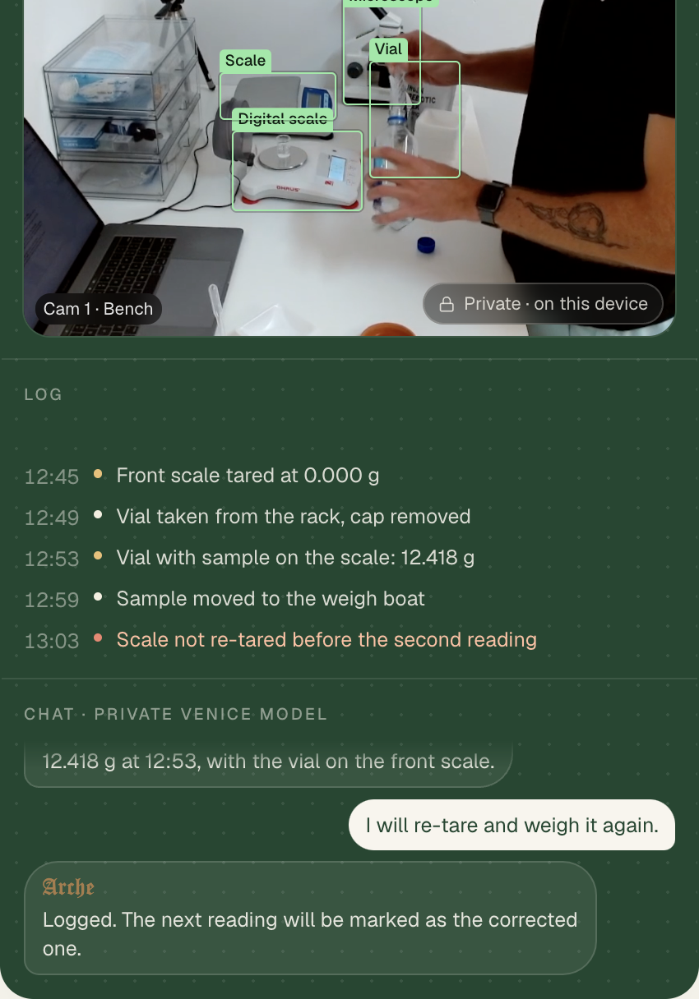
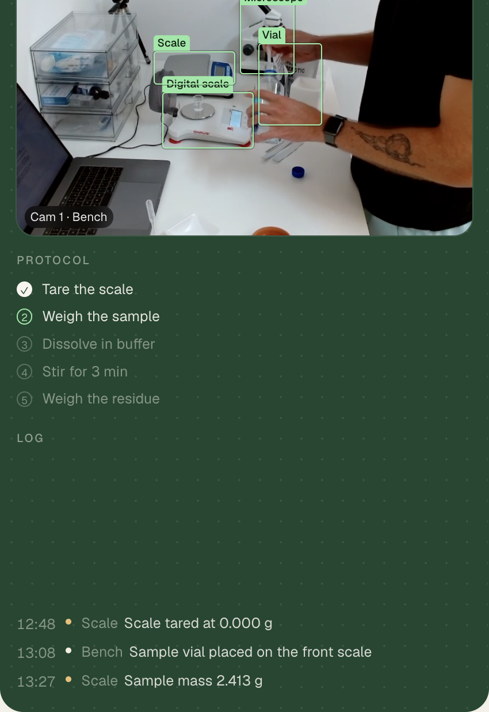
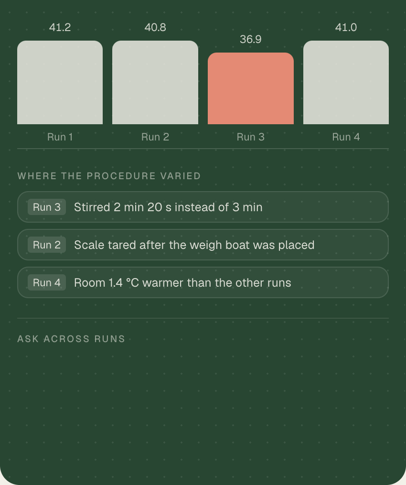

<p align="center">
  
</p>

# Arche Vision

Arche Vision is a camera-based system for the bench. It watches a real world experimental process while you perform it, logs what it sees, and provides assistance. The aim is an assistant that can sit in the lab, and generate a clear record of work that is too messy for a protocol to capture on its own.

You provide context regarding what you plan on doing and what your experimental objective is. Up to four concurrent cameras can watch the bench at once, or you can upload a recording. Based on a single captured frame, AI will predict the visible objects with labels, you can accept, reject or introduce new objects for the system to calibrate around. After that, the system simply runs in the background: about one look a second, a timestamped log as the procedure moves, and chat-interaction drawn from what it has already seen.

It uses private AI. Feed flows to a private vision model, chiefly Qwen3 VL, and only while Venice still marks that model private. (venice.ai) 

This repository is the open edition. You run it on your own machine and bring a [Venice](https://venice.ai) key. The same system is part of [Arche](https://www.archescience.ai), the live product, where Vision sits inside the rest of the lab tools.

<p align="center">
  
</p>

<p align="center">
  
  
  
  
</p>


## What happens in an Arche Vision run 

1. You name the experiment and say what your objective is.
2. You upload a video file or select camera(s) attached to your computer
3. Snapshot a single video frame and AI will identify the objects in it. You can rename them, remove them, or manually introduce new objects.
4. Once launched into the workflow, Arche reads the real-time camera feed ~one frame/second, in stretches of 20 seconds, and writes out a human readable, sentence log when the step changes.
5. You can pause, resume, or stop at any point. A summary is generated upon conclusion.
6. The summary is yours to edit. The run footage and associated data is stored in your browser. 

The video file never leaves the browser. The browser samples frames and sends those frames, your context, and the object names to the server you are running. That server sends them to Venice with your key, and only after Venice’s own model list says the model is private. A model Venice no longer marks private is refused, and nothing is sent.

A log quotes a display only when the characters are legible. It does not invent a measurement. It is a draft notebook, not an instrument reading.

## Run it

Node 20 or newer.

```bash
git clone https://github.com/avwtr/arche-vision.git
cd arche-vision
pnpm install
pnpm dev
```

Open http://localhost:3000 and paste a Venice key. The key is saved in this browser under `arche-vision-key` and is sent only to this server, in the `x-venice-key` header.

To keep the key out of the browser, put it in the environment instead and leave the page’s key field empty:

```bash
cp .env.example .env.local
# set VENICE_API_KEY
pnpm dev
```

A key typed in the page overrides the environment, so a shared computer can still be one person, one key. “Forget key” removes the browser copy.

## What stays here

| Stays on this computer | Sent to Venice, with your key |
| --- | --- |
| The video file, or the camera stream | JPEG frames, one per second, 768 pixels wide |
| The key, except as a header to your own server | The experiment name, your context, and the object names you confirmed |
| The log, the summary, the object names, and the video file, in this browser | The log so far, so the next stretch can continue it |

Venice private models run on Venice’s own or zero-retention infrastructure. That is Venice’s claim, checked against their live model list before every request. This program does not send frames to any other provider.

## Leaving localhost

By default the server answers only on localhost. A copy bound to a public host with `VENICE_API_KEY` set would let anyone who can reach it spend that key.

Set `ARCHE_VISION_OPEN_HOST=1` only when you intend that, you have read this, and the host is not quietly logging request headers. Prefer a key typed in the browser over a key in the environment on any machine you do not fully control.

A run is stored in this browser, the same way Arche’s private-local sessions are. The record and the video file stay on this computer. They are not uploaded to Arche. Reload the page and the run is still there; if it was in the middle of reading, it is paused, and resume continues from the last stretch. Clearing the browser’s site data, or opening another browser, loses it. Download the note or the JSON when you want a copy outside the browser.

The tab has to stay open while a run is actually reading. A reload does not keep the request that was in flight.

A camera watch lasts the number of minutes you set, at most 30, and you can stop it sooner. A file is read from the start to the end. A long file is a long run: one request for every 20 seconds of picture.

## Models

The page offers only the vision models this edition knows, and only when Venice currently marks them private:

- `qwen3-vl-235b-a22b`
- `google-gemma-4-31b-it`

## License

MIT. Copyright Heterodox Labs, Inc. See `LICENSE`.
